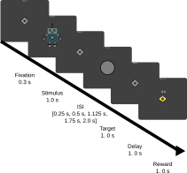

# Go/no-go Task

## Task description

This is a version of the Go/No-go task, as described in Guitart-Masip et al. 2012 [^guitart2012]. This task essentially is a 2 x 2 design, with reward context and action as factors. Over the course of the experiment participants have to learn whether a "go" or a "no-go" response leads to the better outcome (80 \%) of the time. Additionally, there is a reward context, where different stimuli either indicate, whether participants responses lead to winning 1 point or nothing, or to losing 1 point or nothing.

Each trial begins with a fixation period of 0.3 s, after which the stimulus is displayed for 1 s. After a variable inter stimulus interval (fixation), which was randomly drawn from the set $[0.25 s, 0.5 s, 1.125 s, 1.75 s, 2.0 s]$, generated as blocks of 60 trials, uniformly sampled, without replacement, the target stimulus appeared. Participants could then decide to press a button with the left index finger ("go") or to not usher a response ("no-go"). The response window was set to 1 s.
After a delay of 1 s the reward feedback was displayed for 1 s. Each trial was followed by a inter trial interval which was randomly drawn from the set $[0.5 s, 0.75 s, 1.0 s, 1.25 s]$, generated as blocks of 60 trials, uniformly sampled, without replacement. As in other experiments, we added the time left in the response window to the ITI to ensure a reliable trial length.

The pilot study used in early versions procedurally generated abstract cards as stimuli and a brightening of th fixation cross (white borders appearing around the diamond) as a target stimulus. Later versions replaced the card stimuli with robots, which were modeled after Raab et al. 2020[^raab2020], where the colors of the robots were randomly drawn. A final version, replaced the target fixation cross, with a circle that appeared in the middle of the screen, to more closely model the story, that was also described in Raab et al.

Stimulus order was created pseudorandomly and in blocks of 60. Where each block of 60 contained each of the four conditions ("go-win", "go-punish", "nogo-win", "nogo-punish") 15 times. In the first block is was made sure, that participants see each of the four stimuli at least once within the first 8 trials.

Probabilistic rewards were generated pseudorandomly, by permuting lists of length 10 (e.g. [-1, -1, -1, -1, -1, -1, -1, -1, 0, 0]), removing the reward from the list and selecting the next one. After selecting a stimulus 10 times, a new randomly permuted list was generated.

After each set of 60 trials, there was a 45 second break.

## References

[^guitart2012]: Guitart-Masip, M., Huys, Q. J. M., Fuentemilla, L., Dayan, P., Duzel, E., & Dolan, R. J. (2012). Go and no-go learning in reward and punishment: Interactions between affect and effect. NeuroImage, 62(1), 154–166. https://doi.org/10.1016/j.neuroimage.2012.04.024

[^raab2020]: Raab, H. A., & Hartley, C. A. (2020). Adolescents exhibit reduced Pavlovian biases on instrumental learning. Scientific Reports, 10(1), Article 1. https://doi.org/10.1038/s41598-020-72628-w
